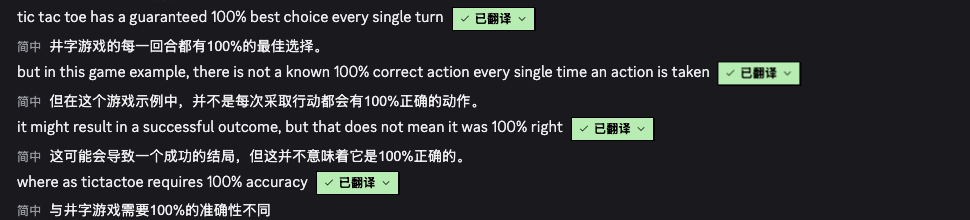
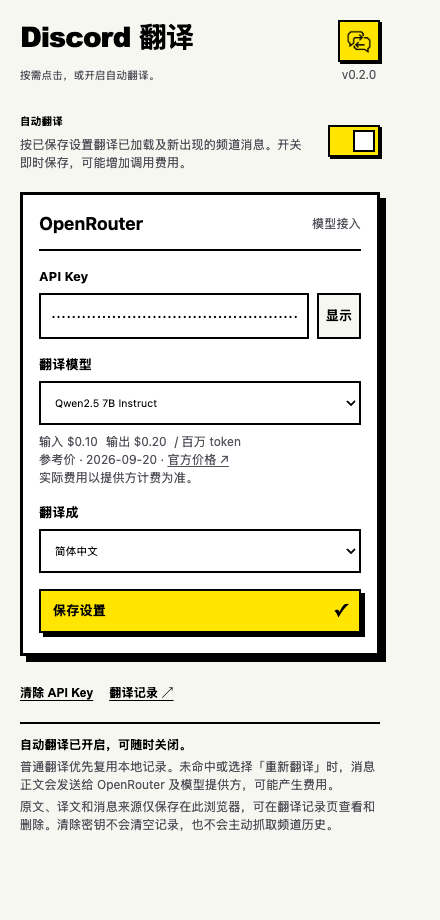
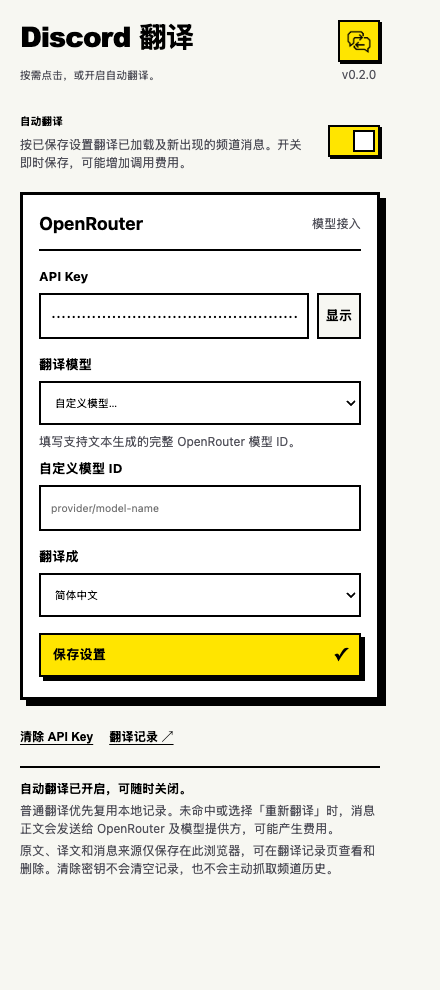
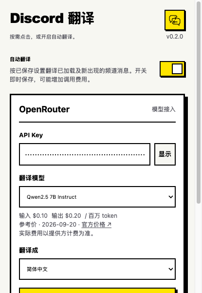
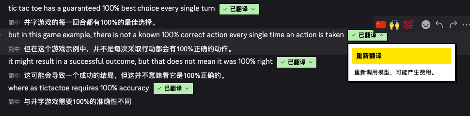
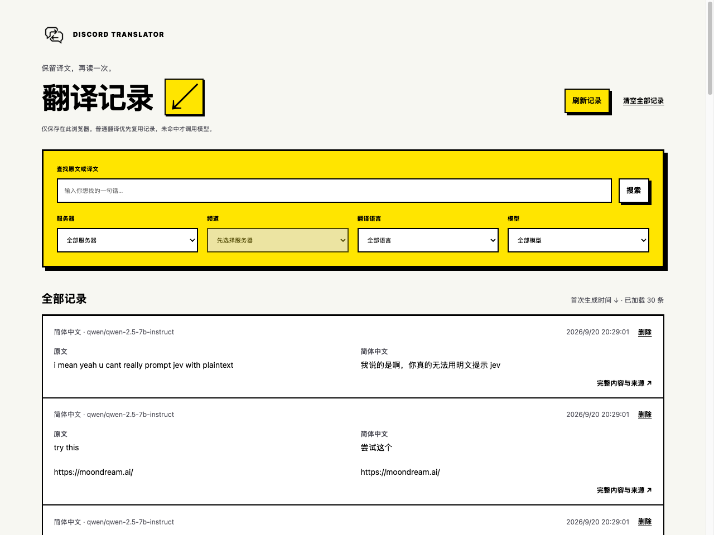
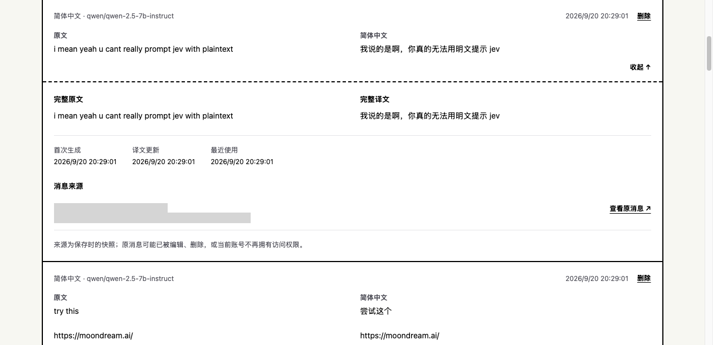

<p align="center">
  
</p>

<h1 align="center">Discord Translator</h1>

<p align="center">在原文下方读懂 Discord。按需翻译，本地留存。</p>

<p align="center">
  
  
  
  
</p>

基于 WXT、SolidJS 和 TypeScript 的浏览器扩展。在 Discord 网页版文字频道里，点击消息即可阅读译文，也可以开启自动翻译。使用你自己的 OpenRouter API Key，选择模型；翻译记录保存在本地，相同内容优先复用。

[功能](#功能) · [界面预览](#界面预览) · [安装](#安装) · [使用](#使用) · [常见问题](#常见问题) · [开发](#开发) · [自动化与发布](#自动化与发布) · [贡献](#贡献) · [许可证](#许可证)



## 功能

| 功能 | 当前能力 |
| --- | --- |
| 按需与自动翻译 | 点击单条消息翻译；自动模式处理已加载及新出现的消息，可随时关闭 |
| 低价模型选择 | 四个内置候选，展示输入/输出参考价格；支持自定义完整模型 ID |
| 多语言 | 简体中文、英文、日文、韩文；默认简体中文 |
| 本地复用 | 原文、模型、目标语言等参数一致时复用记录，避免重复模型调用 |
| 翻译记录 | 搜索原文/译文，按服务器、频道、语言、模型筛选，查看完整内容与消息来源 |
| 显式重新翻译 | 从「已翻译」菜单重新调用模型；失败保留旧译文 |
| 记录管理 | 删除单条或清空记录，操作前确认；不修改 Discord 消息 |

当前支持 **Chrome MV3 + discord.com 普通服务器文字频道**。私信、线程/论坛、桌面 Discord、图片/OCR、附件、语音和输入翻译尚不在支持范围。Firefox 仅做构建兼容检查，尚未完成运行时与商店发布验证。

## 界面预览

以下为 **v0.2.0 真实插件截图**，使用 ego lite 拍摄。API Key 保持遮蔽；聊天身份、服务器和频道标识已裁去或遮蔽。译文来自实际记录，仅展示交互效果，不代表模型质量基准。

### 模型设置

自动翻译开关即时保存；模型和目标语言在点击「保存设置」后生效。价格是标注日期的参考快照。

<p align="center">
  
  
</p>

<details>
<summary>查看工具栏原生弹窗</summary>

实际 popup 可滚动，下图保留其原生 600px 视口。



</details>

### 重新翻译

打开菜单查看操作说明；选择「重新翻译」才会绕过已有记录并重新调用模型。



### 本地翻译记录

原文与译文并排阅读，可搜索、筛选和展开来源。



<details>
<summary>查看完整内容与消息来源</summary>



</details>

截图原文件与拍摄说明位于 [assets/screenshots](assets/screenshots/README.md)。

## 安装

### 从源码构建

需要 **Node.js 24+** 和 npm；`.nvmrc` 指定 Node 24。在项目根目录运行：

```sh
npm ci
npm run build
```

1. 打开 `chrome://extensions`，开启「开发者模式」。
2. 点击「加载已解压的扩展程序」，选择 `.output/chrome-mv3/`。
3. 在工具栏固定 Discord Translator，打开插件设置。
4. 配置 OpenRouter 后刷新 Discord 页面。

### 使用打包文件

仓库发布版本后，可在 GitHub **Releases** 下载 `discord-translator-<版本>-chrome.zip`，解压到固定目录，再按上面的步骤加载。CI 运行的 **Artifacts → chrome-extension** 也会提供测试通过后的安装包。首次 Release 是否存在，以仓库 Releases 页面为准。

更新时替换原目录中的文件，在扩展管理页点击「重新加载」，再刷新 Discord。若移动或重命名了加载目录，需要重新选择目录；仅重载旧扩展不会更新路径。

## 使用

1. **配置模型**：填写自己的 OpenRouter API Key，选择低价候选或自定义模型 ID，选择目标语言，点击「保存设置」。保存成功表示本地配置已保存，可用性在实际翻译时验证。
2. **翻译消息**：在频道中点击「翻译」。先查询本地记录，未命中才调用模型；译文出现在原文下方。失败时查看错误原因，再手动重试。
3. **开启自动模式**：启用设置页顶部「自动翻译」。关闭后停止发起新的自动请求，已有译文保留，已发出的请求仍可能完成并计费。
4. **查看历史**：点击「翻译记录」，搜索或筛选，展开词条查看原文、译文与来源。新记录在刷新后显示；较早记录可以继续加载。
5. **重新生成**：点击「已翻译」右侧箭头，再选择「重新翻译」。新结果生成且保存成功才替换旧记录。

## 数据与隐私

- API Key 保存在扩展本地 `storage.local`，默认遮蔽，仅可信扩展页面可读取。清除 Key 会关闭自动翻译，保留模型选择和翻译记录。
- 未命中记录或主动重译时，消息正文与翻译指令发送给 OpenRouter 及所选模型提供方；作者资料、回复预览、附件与隐藏文本不包含在请求中。
- 原文、译文、翻译参数和消息来源保存在本地 IndexedDB，不云同步。扩展不发送 Discord 发言，也不主动抓取未加载的频道历史。
- 不自动重试、不自动换模型、不截断正文。请求与存储失败会明确显示。

缓存匹配、删除语义、存储失败、数据生命周期详见 [数据与隐私说明](docs/data-and-privacy.md)。

## 常见问题

**翻译需要付费吗？**

模型调用由你的 OpenRouter 账号计费；复用兼容的本地记录不会调用模型。自动模式可能增加调用量。预设价格带核对日期，实际费用以提供方计费为准。

**为什么保存成功后仍然翻译失败？**

保存不验证模型或余额。根据错误检查 API Key、余额、限流和模型能力。仅支持 Chat Completions 文本生成模型；`typesafe/jev-1.13` 这类决策模型不适用于当前接口。

**为什么看不到翻译按钮，或提示扩展连接中断？**

确认处于普通服务器文字频道。扩展更新后重新加载扩展，再刷新 Discord；其他已经打开的 Discord 标签页也需要刷新。插件设置右上角会显示实际加载版本。

**换模型后会复用旧结果吗？**

只有原文、目标语言、模型、提供方和翻译指令版本全部一致才复用。换 Key 不影响兼容记录；换模型、语言或编辑原文不会误用旧译文。

**清除 Key、删除记录、卸载有什么区别？**

清除 Key 保留记录，仍能手动复用已有译文；删除词条会删除其所有频道来源，但不改 Discord 原消息或当前已显示的译文。卸载、更换浏览器配置或扩展 ID 不会自动迁移记录。

## 开发

```sh
npm ci
npm run dev             # Chrome 开发模式与 HMR
npm run compile         # TypeScript 检查
npm test                # Vitest / jsdom 集成测试
npm run build           # Chrome MV3 构建
npm run build:firefox    # Firefox 构建兼容检查
npm run zip             # Chrome 安装包
```

| 目录 | 用途 |
| --- | --- |
| `entrypoints/popup/` | 设置、模型选择与自动翻译开关 |
| `entrypoints/content.ts` | Discord 消息发现与行内交互 |
| `entrypoints/background.ts` | 扩展后台入口 |
| `entrypoints/history/` | 独立翻译记录页 |
| `lib/` | OpenRouter、配置、IndexedDB、翻译协调 |
| `tests/` | 单元与集成回归 |
| `assets/` | 样式、品牌素材、宣传截图 |
| `openspec/` | 能力规格、变更设计与验收任务 |

浏览器验证使用 **ego lite / ego-browser**。实际 Discord、OpenRouter 和原生 popup 验证步骤、历史验收范围及依赖说明见 [开发与验证](docs/development.md)。自动化测试不替代真实模型联调。

## 自动化与发布

- [CI](.github/workflows/ci.yml)：推送 `main`、提交 PR 或手动运行时，按 `.nvmrc` 安装 Node，执行锁文件安装、类型检查、测试、Chrome 打包及 Firefox 构建检查，上传 Chrome ZIP。
- [Release](.github/workflows/release.yml)：推送 `v*` 标签后复用同一套检查，校验标签与 `package.json` 版本一致，再创建 GitHub Release 并附上已验证的 Chrome ZIP。使用仓库 `GITHUB_TOKEN`，仅发布 job 申请 `contents: write`。
- [Dependabot](.github/dependabot.yml)：每周检查 npm 与 GitHub Actions 依赖更新，提交更新 PR。

发布时先同步 `package.json`、`package-lock.json` 和 README 的版本，提交后推送对应 `v<版本>` 标签。流程不会自动提交到 Chrome Web Store，也不会发布 Firefox 安装包。Actions 通过只代表自动检查完成，发布前仍需真实浏览器验收。

实现参考：[GitHub setup-node](https://github.com/actions/setup-node)、[Artifacts](https://github.com/actions/upload-artifact)、[GitHub CLI Release](https://cli.github.com/manual/gh_release_create)。

## 贡献

欢迎通过 GitHub Issues 反馈问题或提交 Pull Request。问题报告请附上扩展版本、浏览器版本、复现步骤、预期与实际行为，以及脱敏截图；不要附上 API Key、Cookie 或私人聊天内容。

开发前阅读 [AGENTS.md](AGENTS.md) 和 [OpenSpec 规格](openspec/specs/)。保持改动聚焦，运行类型检查、相关测试与构建；涉及 UI 时补充真实浏览器截图和验证说明。当前变更及剩余验收项见 [OpenSpec changes](openspec/changes/)。

## 许可证

仓库当前尚未指定许可证，未包含 `LICENSE` 文件。
