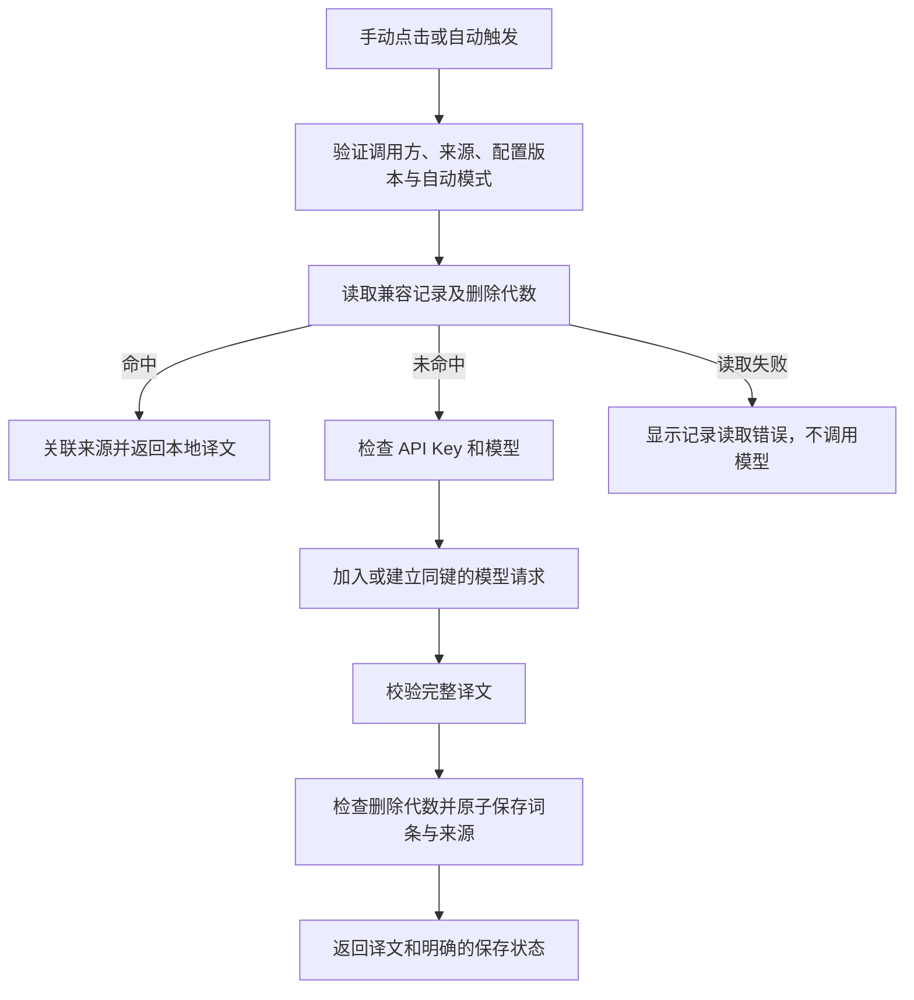

## Context

动机见 [proposal.md](./proposal.md)。当前代码与本次方案的衔接点如下：

| 现有实现 | 本次需要调整的原因 |
| --- | --- |
| `lib/translation-state.ts` 以消息 ID 保存当前频道内存状态；切频道和配置 revision 更新会清空展示 | 页面内状态仍负责 UI 生命周期，持久词条须由独立仓库负责 |
| `lib/background-service.ts` 在读取配置后直接检查密钥并调用 `translateText` | 需在模型凭据检查前增加本地查找，使清除密钥后仍能复用记录 |
| `entrypoints/content.ts` 为手动/自动模式提供同一个请求入口，已修复导航事件早于 URL 提交的问题 | 不另建一套自动缓存逻辑；沿用频道 epoch、正文绑定和请求 ID 校验 |
| `lib/discord-dom.ts` 已提取 channelId/messageId，但未向后台提供服务器身份和标题快照 | 增加固定 Discord 来源描述，不读取账号 token、作者或频道历史 |
| `lib/settings.ts` 只在 `storage.local` 保存配置 | 记录采用独立、可查询的存储，避免大数组覆盖和设置串改 |
| `senderRole` 只区分 popup 与 Discord 内容脚本 | 新增记录页身份及最小 RPC 权限，不能简单将所有扩展页面视为同等可信入口 |
| 当前 Vitest 覆盖后台、正文提取、状态和真实 content/ShadowRoot/Solid 集成 | 扩展这些边界验证，另增加仓库事务和记录页测试 |

用户已确认仅覆盖 Discord；现有普通服务器文字频道边界保持不变。此文定义拟实现方案，不代表功能已交付。已完成的上一版三份规格已同步主规格，本次修改写在独立 delta 中，避免改写原变更的验收历史。

## Goals / Non-Goals

**Goals:**

- 让持久记录独立于内容页生命周期和 API Key 存续，同时保留精确的翻译参数与来源快照。
- 将查找、模型调用、持久化编排放在后台，使手动、自动和多个标签页使用一致的复用规则。
- 为来源查询和分页建立事务化的数据模型，删除语义能覆盖进行中的异步操作。
- 为新记录页复用既有 token 与 SolidJS 组件模式，不改变正常行内译文的占位。
- 显式重译在保留旧结果的前提下完成替换；请求共享覆盖持久提交，翻页位置不随复用变化。

**Non-Goals:**

- 不做跨设备同步、服务端账号体系、语义向量搜索、术语替换、人工编辑译文或导入导出。
- 不接入其他站点、Discord 私信/线程/论坛、未加载历史或 Discord 私有 API。
- 不增加自动过期、后台清理、隐藏容量上限、模型重试或备用提供方。
- 不将记录页浏览行为变成模型请求；首次版本不提供管理页里的远程重译按钮。

## Decisions

### 1. 在扩展后台使用 IndexedDB；设置仍留在 storage.local

新增 `lib/translation-memory.ts`，提供可独立测试的仓库接口；底层使用扩展 origin 下的原生 IndexedDB。只有后台访问仓库，内容脚本与记录页通过受控 RPC 访问。

选择理由：需要按词条去重、按来源查询、分页遍历和原子删除，而不是每次读取/覆盖一个不断增长的 JSON 数组。`storage.local` 继续负责现有小型设置记录，两者不共用数据格式。无需新增网络或全站权限。

不采用 localStorage：后台没有页面 DOM，且整块同步读取不适合此职责。不引入云数据库：用户确认的目标不需要服务端或数据上传。

首次打开数据库创建 version 1；升级逻辑使用明确版本迁移。事务完成才算保存成功。打开失败、升级受阻、数据不合法、事务中止和容量不足返回类型化错误，不能通过删除数据库后重建来恢复。哈希计算与网络请求在事务外完成，事务内只执行仓库读写，避免等待外部异步工作导致事务失活。

### 2. 词条与消息来源分开建模

数据库名拟定为 `discord-translator-history`，包含三个 object store：

| Store | 键与主要字段 | 用途 |
| --- | --- | --- |
| `entries` | `id`、`siteOrigin`、`sourceText`、`translatedText`、`targetLanguage`、`provider`、`model`、`promptVersion`、`createdAt`、`createdSequence`、`updatedAt`、`lastUsedAt` | 一份兼容的译文内容；`id` 来自匹配元组摘要；首次生成时间及首次插入序号不可变，重译只更新译文与更新时间 |
| `sources` | `[entryId, guildId, channelId, messageId]`、`pageTitle`、`sourceUrl`、`firstSeenAt`、`lastSeenAt` | 一个词条可关联多个频道/消息；同来源重复命中只更新时间 |
| `meta` | 集合删除代数、按 entryId 的删除代数、首次插入序号计数器 | 防止迟到写回；为分页固定新增记录的查询边界 |

`entries` 建立 `[createdAt, createdSequence]` 排序索引；时间相同时以唯一插入序号确定顺序。`createdSequence` 在首次插入事务内从计数器分配，复用或重译不改变该值；清空也不回拨计数器。`sources` 建立按 `entryId`、服务器、服务器与频道的索引。来源过滤使用 ID；`pageTitle` 保存 DOM 标题快照用于阅读，不参与匹配键。无法获得展示名称时明确显示服务器/频道 ID，不推测名称或调用 Discord API 补全。

词条和首次来源在同一个 readwrite 事务提交。缓存命中时，在事务中检查词条仍存在、删除代数未变化，再幂等追加来源和更新使用时间。普通生成只创建不存在的兼容词条，不覆盖已有译文；只有显式重译可以原子更新它。管理页每行表示一个词条，详情列出来源；筛选频道时以相关来源判断是否纳入，不重复展示同一词条。

替代方案是每条 Discord 消息各存一份完整译文，但会重复内容且无法清楚表示跨频道复用。仅按消息 ID 缓存也无法支持消息编辑或相同文本出现在别处。

### 3. 使用严格的兼容性键，不使用设置 revision 作为缓存版本

匹配元组为：

```text
["https://discord.com", provider, model, targetLanguage, promptVersion, sourceText]
```

以稳定 JSON 序列化后做 SHA-256 摘要作为 `entryId`；读取记录时同时核对保存的元组字段。`sourceText` 就是现有正文提取函数处理换行和首尾空白后的文本，不再做大小写、标点或内部空白处理。原文有差异就不命中。

在 `lib/openrouter.ts` 为现有 system prompt 定义显式 `promptVersion`，首版记录值为 1；改变翻译指令或影响输出的参数时同步递增。不把随机 `settings.revision`、密钥、自动开关或消息来源纳入键。revision 仍用于内容页配置变更与迟到响应隔离。

模型 ID 与目标语言不同会保留不同词条。换 API Key、重复保存相同参数或切换自动开关不会让已保存内容失效。源语言由现有模型流程自动识别，目前没有可信检测结果，因此不虚构 `sourceLanguage` 字段。

不采用语义相似检索，因为短消息、代码和俚语的近似表达容易产生错误替换。不默认跨模型复用，因为用户切换模型通常意在改变结果质量。

### 4. 普通翻译优先查记录，共享生成工作覆盖保存阶段



`TranslationState.translate` 移除本地 `hasApiKey` 的提前拒绝，让后台有机会命中记录；后台在查找前仍校验请求身份、频道路由、配置 revision 和自动模式，在真正调用模型前检查凭据。保持现有“无配置不能开启自动模式、清除 Key 会关闭自动模式”的设置规则。

后台按「匹配键＋捕获的删除代数」管理生成工作。共享 Promise 的范围是模型调用、响应校验及词条与首次来源的提交，不是在模型文本返回时就结束。候选工作的占位须在第一次异步处理前同步注册；拥有者在真正调用模型前重新检查词条，不能因为早先查找未命中就忽略刚刚完成的其他提交。这样既覆盖模型返回后的保存窗口，也覆盖“先前未命中，随后旧工作提交并退出”的交接窗口。

同一工作中的每个调用方保留自己的 requestId、settingsRevision 和来源。首个提交完成后，其他来源在各自幂等事务内关联同一词条；来源写入失败只影响该调用方的保存状态。只有核心提交已成功或明确失败后，才以工作身份检查并释放共享条目，不能由旧工作的清理逻辑误删后来注册的新工作。提交成功后新请求直接查到持久记录；失败对等待方返回真实错误或未保存状态，不自动重试。后台终止仍按现有连接失败处理，不声称能续跑未完成模型请求。

配置改变造成参数不兼容时匹配键不同；仅密钥改变时语义相同的输出仍可被新调用方复用，如同读取已保存词条。旧调用方的 UI 仍通过自己的 revision 校验丢弃迟到结果。共享的是生成及保存结论，不是某个调用方的完整 RPC 回复。

手动模式不在页面挂载时查询和自动展开历史：用户点击才处理。自动模式继续处理已加载的 idle 消息，区别是优先命中本地。保留 DOM 重挂载去重和失败不自动重试规则。

### 4.1 显式重译绕过记录，成功提交后替换

`translation.request` 增加 `forceRefresh` 意图，只有用户从消息操作菜单选择「重新翻译」时设置。`automatic` 与 `forceRefresh` 同时为 true 的请求明确拒绝；普通失败重试仍采用记录优先，重译失败只能由再次选择明确的重译动作重试。重译使用当前正文、已保存模型/目标语言、现行 promptVersion 和当前凭据，不能用缓存结果掩盖缺少密钥或模型错误。

同键已有普通生成工作时，显式重译串接在它结束之后，再执行一次新的模型调用，不把早先的普通结果当成新译文。多个同时到达的显式重译共享同一个等待中或执行中的重译工作，直到保存结束。同键没有旧工作时直接创建重译工作。各操作在被接受时捕获删除代数，排队后不得重新捕获新代数绕过期间发生的删除；执行前发现已删除则结束并明确告知，不再发出新的模型请求。

重译期间普通查询仍可读到已提交的旧词条；若普通查询未命中且已有同键重译工作，则可等待该工作，不另起普通生成。各个词条保持独立，无全局并发上限。串接关系防止普通生成晚于重译写回，仓库的普通保存也仅允许插入而非覆盖。

成功重译在单个事务内核对删除代数、更新相同键的 `translatedText/updatedAt/lastUsedAt` 并关联当前来源，保留全部既有来源、`createdAt/createdSequence`。参数变化导致键不同则创建新词条，不更新原键；若原结果从未落盘，也按首次保存处理。事务失败不删除、不部分覆盖旧词条。当前页面在模型和保存都成功后替换译文；其他已经展示的消息保持当前快照，后续查找使用新记录，不批量改变用户正在阅读的内容。

`TranslationState` 在已成功结果旁增加独立的重译进度、错误和未保存候选状态。等待期间保留原文/旧译文，禁止重复提交；模型失败保留旧译文并显示重译错误。模型成功但更新失败时，旧译文仍为当前结果，新文本可在「新译文未保存」区域展开查看，不能标记为更新成功。正文、频道或配置发生变化时，原结果快照与重译结果一并受现有 epoch/requestId/revision 校验约束，不能在错误恢复时把旧结果插回新消息。

不采用“先删除再重译”，因为上游或存储失败会丢掉仍可用的旧记录；也不让普通缓存命中覆盖用户明确要求的新生成。

### 5. 来源在请求时快照，所有结果仍服从内容页生命周期

`lib/discord-dom.ts` 增加支持路由的服务器/频道解析；请求增加来源 URL 与页面标题快照。后台验证固定 origin、普通服务器频道路径、字符串形式的 ID，以及来源频道与请求 channelId 一致。调用方身份检查使用扩展 ID、主框架和 `sender.url` 的 Discord origin；当前服务器/频道必须与浏览器原生提供的 `sender.tab.url` 核对，缺失时明确拒绝，不能退回文档 URL 或接受任意来源链接。实页验证确认 SPA 导航后 `sender.url` 可停留在文档首次加载的频道，而 `sender.tab.url` 已更新；两者不能混用。

原消息链接由校验后的 guildId、channelId、messageId 构造：`https://discord.com/channels/{guildId}/{channelId}/{messageId}`，不保存 query/hash、作者资料或相邻正文。标题只保存为纯文本，不参与鉴权。

请求开始后来源快照不可改变。频道切换或正文编辑后的旧结果可以作为原正文的历史记录保存，但不能插入当前视图。历史明确表示记录时的快照；同一消息编辑前后的不同正文形成不同词条，均可指向原消息链接。

保留 `entrypoints/content.ts` 的 `event.newUrl.href` 导航逻辑，避免改回依赖尚未更新的 location.href。手动点击/自动处理实际挂载的新频道正文时再取得来源，并在后台做一致性检查，路由不一致明确失败，不记录成错误来源。

### 6. 删除使用事务和代数校验，不靠取消网络请求保证

查找/开始模型调用时捕获集合代数和该 entryId 的删除代数。单条删除在一个事务内递增其删除代数、删除词条和全部来源；清空在一个事务内递增集合代数并清空词条、来源和逐条删除标记。代数不包含消息内容或密钥。

写回事务在同一事务中再次读取并比较代数，发生变化则不写入，返回 `not-saved` 与明确的 `deleted` 原因。这样已经发出的请求仍能给有效的原消息显示译文，但不能在删除之后偷偷重建记录。删除后的新请求捕获新代数，不加入旧的在途组，可正常保存。

删除只影响持久记录，不清空所有内容页已经展示的结果，也不使其立即自动重译。确认文案说明该行为。缓存命中后、来源关联提交前若词条被删除，必须返回明确的记录已删除状态，不能当作静默未命中继续付费调用。

不依赖 AbortController：停止等待不保证提供方未计费，也不能保证网络请求实际终止。

### 7. 扩展契约明确区分翻译来源和保存状态

扩展 `TranslationResult`，保留原有 requestId/revision/model/targetLanguage，新增：

| 字段 | 语义 |
| --- | --- |
| `origin: 'model' \| 'memory'` | 本次结果由模型生成还是读取已保存词条 |
| `persistence.status: 'saved' \| 'not-saved'` | 词条和此次来源是否已完成保存 |
| `entryId` | 匹配词条身份，用于 UI 状态与仓库关联，不是任意授权令牌 |
| `persistence.error?` | 未保存原因：写入失败、来源关联失败或用户删除；仅结构化非敏感信息 |

读取错误、删除竞争和无效存储数据使用明确的 history 错误类型，正常空库返回显式未命中，不通过异常表示。模型成功但存储失败是“翻译成功、保存失败”的双重结果，不能扔掉译文或伪装为完整成功。

后台新增角色 `history`，只接受本扩展固定 `history.html` URL；为消息定义显式权限矩阵：

| RPC | 调用方 | 行为 |
| --- | --- | --- |
| `translation.request` | Discord 主框架内容脚本 | 普通请求本地优先；显式 forceRefresh 绕过结果复用；只返回本次结果 |
| `history.open` | popup | 打开固定记录页，不保存表单 |
| `history.list` / `history.filters` / `history.get` | history | 带来源/语言/模型筛选、分页与详情，不返回密钥 |
| `history.delete` / `history.clear` | history | 确认后删除记录；失败不报成功 |
| 现有 `settings.*` | 保持既有角色授权 | history 不因新角色而取得 settings.get/save/clearKey 权限 |

后台是唯一读写入口，记录页无需直接读取设置。内容页不得枚举或删除整个记录库；记录页不得发起任意远程翻译。完整文本不写日志，错误详情不包含 provider 原始响应或授权 Header。

### 8. 新增独立记录页，继承现有视觉

WXT 新增 `entrypoints/history/index.html`、`main.tsx`、`App.tsx` 和样式，构建为 `history.html`。`history` 是 WXT 的保留入口名，需通过 `entrypoints:found` hook 明确设为 `unlisted-page`；构建验收必须确认 manifest 没有 `chrome_url_overrides`，不接管浏览器自带历史页。popup 增加「翻译记录」入口；不扩大 popup 宽度或改变未保存表单。

布局：页头显示标题、刷新和「清空全部」；筛选区包含服务器、频道、目标语言、模型和搜索框；下方为有清晰分隔线的原文/译文列表，点击展开完整内容及来源。桌面宽度可并列显示原文/译文，窄屏顺序堆叠。复用 `assets/styles/tokens.css` 和 `controls.css` 的电光黄、黑色边框、纸色背景、直角与焦点规范，不增加新配色体系或展示无意义指标卡。

列表以不可变的 `(createdAt, createdSequence)` 降序排列，最近使用和重译更新时间只展示。首屏读取插入序号上界，后续游标携带相同上界及最后一个排序键，仅遍历不超过上界的既有词条；新增记录通过刷新纳入，即使时间相同或系统时钟调整，也不会混入当前查询。复用和重译不会移动已存在词条的位置。页大小只是展示分页，不是保存数量上限。

来源过滤使用索引，文本搜索在本地游标遍历时做原文/译文子串比较，不把全部记录发送给模型或一次挂入 DOM。搜索可忽略大小写，但这不改变翻译匹配规则。筛选变化清除旧游标，以查询序号隔离迟到回复；追加页面按 entryId 去重。上界固定的是词条成员的新增边界，不复制完整内容快照；删除、来源关联或重译改变搜索内容后，用户刷新以重新获取匹配集合，不将这种变化冒充静态搜索快照。

详情展示原文、译文、模型、目标语言、首次生成/重译更新/最近使用时间和多个来源。固定由后台构造的 Discord 链接通过普通链接打开新标签页。删除确认明确“这个词条的所有频道来源”或“全部记录”，包含不会删除 Discord 发言、不会擦除当前已显示译文的简短说明；操作成功才更新 UI。

行内正常结果保持现有 4px 顶间距、14px/22px 正文和简短语言标签。本地记录与模型生成的成功结果统一显示「已翻译」；命中记录时，用 accessible name/title 说明「来自本地记录，未调用模型」，不多放一行来源信息。成功标记与菜单箭头使用同一线稿 SVG 样式：使用 `--dt-inline-icon-size: 12px`（按钮内局部覆盖默认图标尺寸），24 × 24 viewBox、2 单位描边、圆端点与圆连接、`currentColor`，通过 inline-flex 垂直居中。消息按钮最小高度 24px，字号/行高 12px/18px，内边距 2px 6px、图文间距 4px，边框与硬阴影各 1px；设置页及菜单维持原尺寸。箭头关闭时朝下，展开时朝上，不使用字体字符；装饰图标设 `aria-hidden` 且不接受焦点，菜单状态由按钮的 `aria-haspopup`/`aria-expanded` 表达。成功状态按钮可打开操作菜单，只有明确选择「重新翻译」才发请求；菜单标明会调用模型，支持键盘和 Escape 关闭并恢复焦点。原位置显示「重新翻译中…」，译文区域继续显示旧结果；失败显示可辨识原因及可展开的未保存候选文本。仅异常信息占用额外空间，菜单和按钮不常驻新增一行。

## Risks / Trade-offs

- [本地记录会积累用户阅读内容] → 只记录已成功处理的可见正文；在设置和记录页说明保存与删除行为，不云同步，清除密钥不等于清空记录。
- [存储容量不足或事务异常] → 暴露明确错误；读失败不转付费调用，写失败保留译文并标记未保存，不静默清理或截断记录。
- [精确匹配减少命中率] → 优先保证正确性，保留标点、代码、大小写和模型差异；不引入模糊匹配。
- [相同模型 ID 背后的模型可能变化] → 显示模型、首次生成与重译更新时间，用户可显式重新翻译；不宣称别名标识不可变，也不隐藏自动失效策略。
- [全库文本搜索在大量记录下变慢] → 索引先限制来源、游标遍历、分批渲染；需要基准数据验证性能，不能用丢数据或假空列表解决。
- [MV3 重启会丢失在途合并状态] → 已提交记录仍持久化；未完成操作按连接中断显式失败，不自动重试和重复计费。
- [目录改名或重装可能改变扩展身份] → 文档区分同一安装内的正常重启与卸载/换扩展 ID；不承诺不同扩展身份之间自动迁移本地数据库。
- [旧变更尚未归档] → 本次基于已同步主规格写 delta；未来归档需先处理旧变更，再合并本变更，避免旧 ADDED 需求覆盖新行为。

## Migration Plan

1. 在新 change 内完成规格、设计和任务；主规格当前仅包含上一版已实现基线，不提前同步本次新功能。
2. 实现时首次初始化空记录库，继续读取现有设置；不修改凭据，不声称能补回此前仅存在页面内存的译文。
3. 添加仓库测试、后台/状态/内容脚本回归和记录页集成测试；验证零网络命中、跨频道来源、存储错误、覆盖提交阶段的并发共享、固定创建顺序分页、重译原子更新及失败保留旧结果、删除和迟到结果。
4. 用 Node 24 执行类型检查、测试、Chrome/Firefox 构建和 OpenSpec 严格校验。Firefox 仍只做构建检查。
5. ego lite 加载当前目录构建，在真实 Discord 完成首次模型翻译及保存，刷新/切频道后复用并观测无新增模型请求；验证显式重译确实调用模型、成功更新与失败保留旧译文、记录页、稳定分页、搜索、来源导航、清密钥后复用、删除，以及重启持久性。截图和记录保存在忽略的 `.artifacts/`，不提交真实聊天正文或凭据。
6. 回滚实现时恢复上一版入口和翻译链路，不删除数据库或设置；回滚版本不读取新记录库。重新启用本功能时按数据库版本继续读取，不能通过回滚抹除用户数据。
